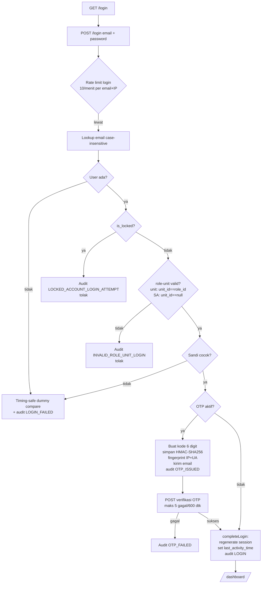
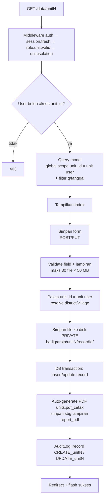
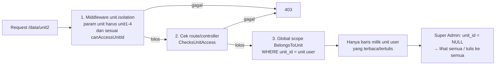

# Dokumentasi Sistem BADIG

**BADIG — Basis Data Terintegrasi Sat Intelkam**

Aplikasi web pengelolaan data intelijen/internal terpusat untuk Satuan Intelkam: pengarsipan data per-Unit (Unit 1–4), basis data orang/DPO (Daftar Pencarian Orang), pengelolaan lampiran/file, pembuatan laporan PDF, jejak audit, backup basis data, serta administrasi pengguna dan hak akses — dengan isolasi data antar-unit yang ketat.

| | |
|---|---|
| **URL produksi** | `https://badig.sardev.biz.id` |
| **Framework** | Laravel `^13.8` (PHP `^8.3`) |
| **Basis data** | MySQL (default) / SQLite — driver sesuai `DB_CONNECTION` |
| **Frontend** | Blade + Alpine.js + Tailwind CSS v4 + Vite 8 |
| **Lokalasi** | `id` (Indonesia) |
| **Berkas dokumentasi ini** | `docs.md` (root project) |

---

## Daftar Isi

1. [Ringkasan Sistem](#1-ringkasan-sistem)
2. [Tech Stack & Dependensi](#2-tech-stack--dependensi)
3. [Struktur Project](#3-struktur-project)
4. [Instalasi dari Nol (Lokal)](#4-instalasi-dari-nol-lokal)
5. [Akun Default & Seeding](#5-akun-default--seeding)
6. [Model Peran (5 Role)](#6-model-peran-5-role)
7. [Penjelasan Fitur](#7-penjelasan-fitur)
8. [Alur & Workflow Sistem](#8-alur--workflow-sistem)
9. [Peta Route Lengkap](#9-peta-route-lengkap)
10. [Skema Basis Data & Model](#10-skema-basis-data--model)
11. [Autentikasi & Otorisasi](#11-autentikasi--otorisasi)
12. [Isolasi Unit (Mekanisme Multi-Tenancy)](#12-isolasi-unit-mekanisme-multi-tenancy)
13. [Middleware & Keamanan](#13-middleware--keamanan)
14. [Manajemen Lampiran & Penyimpanan File](#14-manajemen-lampiran--penyimpanan-file)
15. [PDF & Ekspor](#15-pdf--ekspor)
16. [Backup Basis Data](#16-backup-basis-data)
17. [Jejak Audit (Audit Trail)](#17-jejak-audit-audit-trail)
18. [Frontend & Desain](#18-frontend--desain)
19. [Konfigurasi (.env & config/)](#19-konfigurasi-env--config)
20. [Rate Limiting](#20-rate-limiting)
21. [Pengujian (Testing)](#21-pengujian-testing)
22. [Perintah Berguna](#22-perintah-berguna)
23. [Deployment / Hosting](#23-deployment--hosting)
24. [Checklist Sebelum Go-Live](#24-checklist-sebelum-go-live)
25. [Troubleshooting](#25-troubleshooting)
26. [Catatan Teknis, Tech Debt & Keamanan](#26-catatan-teknis-tech-debt--keamanan)
27. [Glossary](#27-glossary)

---

## 1. Ringkasan Sistem

### Apa itu BADIG?

BADIG adalah aplikasi web internal yang berfungsi sebagai **satu-satunya pintu basis data intelijen Sat Intelkam**. Sistem ini menggantikan pengarsipan manual/per-unit yang terpisah dengan satu sistem terpusat yang:

- **Terisolasi per-unit** — setiap operator unit hanya melihat dan mengelola data unitnya sendiri (kecuali Super Admin).
- **Terkendali** — setiap akses dicatat ke jejak audit (`audit_logs`) yang bersifat **immutable** (di-bar di tingkat database via MySQL trigger).
- **Terintegrasi** — memiliki basis data orang/DPO lintas-unit, file manager lintas-unit untuk pimpinan, laporan PDF otomatis, dan backup basis data bawaan.

### Cakupan Fungsional

| Area | Fungsi |
|---|---|
| Auth & sesi | Login email+sandi, OTP opsional (2FA via email), kunci akun, idle timeout, pembatasan percobaan gagal |
| Data Unit 1–4 | CRUD arsip per-unit (ideologi, ekonomi, sosbud, keamanan), filter, lampiran, PDF per-dokumen & rekap |
| Database Orang (DPO) | Basis data master orang/buronan lintas-unit, import CSV/Excel, foto & bukti, PDF DPO |
| File Manager | Pengelolaan lampiran per-unit + tampilan global lintas-unit untuk pimpinan |
| Dashboard | Statistik per-unit, grafik tren (Chart.js), peta sebaran (Leaflet/OSM), aktivitas terkini |
| Administrasi | Manajemen user (Admin IT), manajemen unit (Super Admin), audit trail, backup SQL |
| Keamanan | Security headers + CSP, rate limiting, isolasi unit di 3 lapis (route/middleware/scope), enkripsi field sensitif |

### Apa yang TIDAK dimiliki sistem ini

- **Tidak ada API publik** — tidak ada `routes/api.php`; semua rute via web (`routes/web.php`).
- **Tidak ada pembayaran, notifikasi push, atau integrasi pihak ketiga** selain OpenStreetMap (opsional, nonaktif default) dan SMTP untuk OTP.
- **Tidak ada antrian job yang aktif** — `QUEUE_CONNECTION=database` disiapkan, tetapi tidak ada job yang di-dispatch.
- **Tidak ada scheduled task** — tidak ada `Schedule::` di mana pun.

---

## 2. Tech Stack & Dependensi

### Backend (Composer)

| Paket | Versi | Fungsi |
|---|---|---|
| `laravel/framework` | ^13.8 | Framework utama |
| `barryvdh/laravel-dompdf` | ^3.1 | Generasi PDF (laporan, dokumen, DPO) |
| `maatwebsite/excel` | ^3.1 | Import Excel database orang |
| `livewire/livewire` | ^3.7 | Terpasang, **praktis tidak dipakai** (tidak ada komponen Livewire) |
| `livewire/flux` | ^2.15 | Terpasang untuk ikon & token CSS saja |
| `laravel/tinker` | ^3.0 | REPL artisan |

Dev: `phpunit ^12.5`, `laravel/pint` (formatter), `laravel/pail` (log tail), `fakerphp/faker`, `mockery`.

### Frontend (npm — semua devDependency)

| Paket | Fungsi |
|---|---|
| `vite ^8.1.4` + `laravel-vite-plugin ^3.1.0` | Build asset & dev server (HMR) |
| `tailwindcss ^4.3.2` + `@tailwindcss/vite` | Utility-first CSS (Tailwind v4, via `@import 'tailwindcss'`) |
| `alpinejs ^3.14.9` | Interaktivitas ringan di Blade |
| `concurrently ^9.0.1` | Menjalankan server, queue, log, vite sekaligus (`composer dev`) |

### Library CDN (dimuat via view)

- **Chart.js 4.4.9** (`cdn.jsdelivr.net`) — grafik dashboard.
- **Leaflet 1.9.4** (`unpkg.com`) — peta sebaran & pemilih koordinat (tile OpenStreetMap).
- **Google Material Symbols** + **Inter (fonts.bunny.net)** — ikon & tipografi.

### Script Composer

| Perintah | Fungsi |
|---|---|
| `composer setup` | Instalasi penuh: `composer install` → salin `.env` → `key:generate` → `migrate --force` → `npm install` → `npm run build` |
| `composer dev` | Jalankan 4 proses bersamaan: `php artisan serve` + `queue:listen` + `pail` (log) + `npm run dev` |
| `composer test` | `config:clear` lalu `php artisan test` |

---

## 3. Struktur Project

```
badig/
├── app/
│   ├── Console/Commands/       # security:migrate-private-files
│   ├── Http/
│   │   ├── Controllers/        # Semua controller (rute + legacy)
│   │   │   └── Concerns/       # Trait HasAuditLog, ChecksUnitAccess
│   │   └── Middleware/         # SecurityHeaders, CheckRole, EnsureSessionFresh,
│   │                           # EnsureRoleUnitConsistency, UnitIsolation
│   ├── Imports/                # DatabaseOrangImport (Excel)
│   ├── Models/                 # User, Unit, Unit1-4, DatabaseOrang, DataAttachment,
│   │   └── Concerns/           #   AuditLog, SystemBackup, District, Village, dll.
│   │                           #   BelongsToUnit ← jantung isolasi unit
│   ├── Providers/              # AppServiceProvider (rate limiter, HTTPS, @cspNonce)
│   └── Services/               # SecureMediaStorage, DocumentMediaService,
│                               # StaticMapService, AuditService, SecureFileService
├── bootstrap/
│   ├── app.php                 # Routing/middleware/alias/health endpoint
│   └── providers.php
├── config/                     # Laravel default + config/security.php (kustom)
├── database/
│   ├── migrations/             # 28 migration (framework + SIBDI + BADIG)
│   ├── seeders/                # DatabaseSeeder → AdminSeeder
│   └── factories/
├── public/                     # Docroot web standar (aset, logo, favicon)
├── resources/
│   ├── css/app.css             # Tailwind 4 + token desain BADIG (dark default)
│   ├── js/app.js               # Bootstrap Alpine + theme manager
│   └── views/
│       ├── layouts/            # app.blade.php (auth), guest.blade.php
│       ├── components/         # layout/ (sidebar, topbar, seo-head) + ui/ (card, table…)
│       ├── auth/, dashboard/, units/, database-orang/, admin/,
│       ├── super-admin/, pimpinan/, profile/, documents/, reports/, privacy…
├── routes/
│   ├── web.php                 # SEMUA rute aplikasi
│   └── console.php             # hanya `inspire`
├── storage/app/private/        # Upload privat: arsip, database-buronan, profile-photos, backups
├── tests/                      # Unit + Feature (PHPUnit 12)
├── backups/                    # ⚠ Snapshot kode saat update (bukan backup DB)
├── index.php                   # Shim front-controller untuk shared hosting (docroot = root)
├── .htaccess                   # Rewrite ke public/ + pin PHP 8.4 cPanel
├── .env                        # Konfigurasi lokal (jangan di-commit)
├── .env.example                # Template konfigurasi
└── docs.md                     # Dokumen ini
```

> **Catatan:** backup SQL yang dihasilkan aplikasi tersimpan di `storage/app/private/backups/`, **bukan** di folder `backups/` root.

---

## 4. Instalasi dari Nol (Lokal)

### 4.1 Prasyarat

| Komponen | Versi minimum | Cek |
|---|---|---|
| PHP | **8.3+** (ekstensi: `pdo_mysql`/`pdo_sqlite`, `mbstring`, `openssl`, `gd` untuk peta/PDF gambar, `zip` untuk Excel, `bcmath`, `intl`) | `php -v` |
| Composer | 2.x | `composer -V` |
| Node.js | 18+ (20+ disarankan) | `node -v` |
| npm | tersedia bersama Node | `npm -v` |
| MySQL | 8.x (atau MariaDB 10.4+) — **direkomendasikan** karena trigger audit butuh MySQL | `mysql -V` |

> SQLite bisa dipakai untuk coba-coba, namun **trigger immutable `audit_logs` (`trg_audit_logs_no_update` / `trg_audit_logs_no_delete`) hanya dibuat di MySQL.**

### 4.2 Langkah Instalasi

```bash
# 1. Masuk ke folder project
cd E:/Projects/Laravel/badig

# 2. (Jika project baru dari git) salin env
cp .env.example .env          # Windows (Git Bash): cp .env.example .env

# 3. Install dependensi PHP + build aset (cara tercepat — semua otomatis)
composer setup
```

`composer setup` menjalankan berurutan:

1. `composer install`
2. salin `.env.example` → `.env` (jika `.env` belum ada)
3. `php artisan key:generate`
4. `php artisan migrate --force`
5. `npm install --ignore-scripts`
6. `npm run build`

**Alternatif manual** (jalankan per langkah jika ingin mengontrol):

```bash
composer install
cp .env.example .env
php artisan key:generate

# Siapkan database dulu (MySQL):
mysql -u root -e "CREATE DATABASE badig CHARACTER SET utf8mb4 COLLATE utf8mb4_unicode_ci;"
#    → sesuaikan DB_DATABASE, DB_USERNAME, DB_PASSWORD di .env

php artisan migrate
php artisan db:seed           # membuat akun default (lihat bagian 5)

npm install
npm run build                 # aset produksi ke public/build
```

### 4.3 Konfigurasi `.env` Minimal untuk Lokal

Buka `.env`, sesuaikan minimal baris berikut:

```env
APP_NAME=BADIG
APP_ENV=local
APP_DEBUG=true                      # true HANYA untuk lokal
APP_URL=http://localhost:8000
APP_LOCALE=id

DB_CONNECTION=mysql
DB_HOST=127.0.0.1
DB_PORT=3306
DB_DATABASE=badig
DB_USERNAME=root
DB_PASSWORD=

SESSION_DRIVER=database             # butuh tabel sessions (ada di migration)
SESSION_SECURE_COOKIE=false         # false untuk http://localhost
SESSION_LIFETIME=30

MAIL_MAILER=log                     # lokal: OTP dicatat ke laravel.log
# MAIL_* diisi hanya jika mengaktifkan AUTH_OTP_ENABLED=true
```

> Setelah mengubah `.env`, jalankan `php artisan config:clear` (atau `php artisan config:cache` untuk produksi).

### 4.4 Menjalankan Aplikasi

**Cara A — satu perintah (disarankan untuk development):**

```bash
composer dev
```

Menjalankan 4 proses paralel: server (`php artisan serve` → `http://127.0.0.1:8000`), worker queue, tail log (Pail), dan Vite dev server (HMR).

**Cara B — manual, dua terminal:**

```bash
# Terminal 1 — backend
php artisan serve

# Terminal 2 — frontend
npm run dev
```

Buka `http://127.0.0.1:8000` → otomatis dialihkan ke `/login`.

### 4.5 Menjalankan Test

```bash
composer test          # atau: php artisan test
```

Lingkungan test memakai SQLite `:memory:` + cache/session array (lihat `phpunit.xml`).

---

## 5. Akun Default & Seeding

Seeder: `database/seeders/DatabaseSeeder` → `AdminSeeder` (idempoten).

**Membuat 1 akun per peran** dengan format email `*@badig.sardev.biz.id`:

| Peran | Email default | Kata sandi default |
|---|---|---|
| Super Admin (role 5) | `admin@badig.sardev.biz.id` | `BadigAdmin2026!` |
| Unit 1 — Ideologi Politik | `unit1@badig.sardev.biz.id` | `BadigAdmin2026!` |
| Unit 2 — Ekonomi | `unit2@badig.sardev.biz.id` | `BadigAdmin2026!` |
| Unit 3 — Sosial Budaya | `unit3@badig.sardev.biz.id` | `BadigAdmin2026!` |
| Unit 4 — Keamanan Negara | `unit4@badig.sardev.biz.id` | `BadigAdmin2026!` |

Override via env sebelum `db:seed`:

```env
ADMIN_EMAIL=someone@example.com
ADMIN_PASSWORD=KataSandiKuat123!
UNIT1_EMAIL=...   # UNIT2_EMAIL, UNIT3_EMAIL, UNIT4_EMAIL
UNIT_PASSWORD=...
```

Perilaku seeder:

- Jika user sudah ada → **tidak mengubah password yang sudah ada**, hanya memastikan `role_id`/`unit_id` benar.
- Memastikan baris `units` 1–4 selalu ada.
- Menjalankan: `php artisan db:seed` (atau `php artisan migrate --seed`).

> ⚠ `.env.example` masih menyebut `BadigAccountSeeder` + `INITIAL_SUPER_ADMIN_*` — seeder tersebut **tidak ada** di codebase. Gunakan `AdminSeeder` (bagian ini).

---

## 6. Model Peran (5 Role)

Sistem memakai **model peran integer tetap** (`users.role_id` 1–5) — tanpa paket permission pihak ketiga, tanpa policy. Hak akses ditentukan oleh kombinasi **role + unit**.

| `role_id` | Peran | Akses |
|---|---|---|
| **1** | Unit 1 — Ideologi Politik | Data & file manager Unit 1 saja |
| **2** | Unit 2 — Ekonomi | Data & file manager Unit 2 saja |
| **3** | Unit 3 — Sosial Budaya | Data Unit 3 + **Database Orang (DPO)** |
| **4** | Unit 4 — Keamanan Negara | Data & file manager Unit 4 saja |
| **5** | **Super Admin** | Semua unit, Database Orang, Admin IT (`/admin-it/*`), Panel Super Admin (`/super-admin/*`), File Manager Pimpinan (`/pimpinan/*`), Reports, Backup |

### Invarian role–unit (divalidasi saat login + middleware `role.unit.valid`)

- Role 1–4 → **wajib** `unit_id === role_id`.
- Role 5 (Super Admin) → **wajib** `unit_id === null`.
- Pelanggaran → login **ditolak** (`INVALID_ROLE_UNIT_LOGIN`) atau sesi dicabut.

### Kontrol akses bertingkat

1. **Route middleware** — `role:5`, `role:3,5` (alias `CheckRole`).
2. **Controller** — `authorizeSuperAdmin()`, `canAccessDatabaseOrang()`.
3. **Middleware `unit.isolation`** — memvalidasi param `{unit}` cocok `unit1..unit4` dan user boleh mengakses unit tsb.
4. **Global scope `BelongsToUnit`** — semua query model unit otomatis difilter `unit_id` milik user (pembelaan terakhir meski route lolos).

---

## 7. Penjelasan Fitur

### 7.1 Halaman Publik & Autentikasi

| Rute | Fungsi |
|---|---|
| `/` | Root: jika sudah login → `/dashboard`, else → `/login` |
| `/login` | Form login (email + password) |
| `/privacy` | Halaman kebijakan privasi (statis) |
| `/sitemap.xml` | Sitemap XML (cache 1 jam) — hanya halaman publik |
| `/robots.txt` | Melarang crawl `/dashboard`, `/data/`, `/database-orang`, `/admin-it/`, `/super-admin/`, `/pimpinan/`, `/profile` |

**Fitur login:**

- Pencarian email case-insensitive (`LOWER(email) = ?`).
- Perbandingan sandi **timing-safe** (selalu membandingkan dummy hash untuk mencegah user-enumeration via timing).
- Akun terkunci (`is_locked`) → ditolak + audit `LOCKED_ACCOUNT_LOGIN_ATTEMPT`.
- Invarian role–unit gagal → ditolak + audit `INVALID_ROLE_UNIT_LOGIN`.
- Gagal berkali-kali diaudit (`LOGIN_FAILURE_THRESHOLD` setiap N percobaan, default 5) dengan rate limit khusus `failed-password:{sha256(email)}|ip` (jendela 900 detik).
- **OTP opsional** (`AUTH_OTP_ENABLED=true`): kode 6 digit dikirim via email, disimpan sebagai **HMAC-SHA256** (bukan plaintext), TTL 1–5 menit (`AUTH_OTP_TTL_MINUTES`), terikat ke fingerprint sesi (IP + User-Agent), maks 5 verifikasi gagal per 600 detik.
- Sukses → `session()->regenerate()`, set `last_activity_time`, audit `LOGIN`.

### 7.2 Dashboard (`/dashboard`)

- Kartu statistik: jumlah data per unit yang boleh diakses, jumlah user, audit, backup.
- **Grafik Chart.js**: tren `kategori` Unit 4 (`unit4Chart`) & pie `kategori` Unit 2 (`unit2Chart`).
- **Peta Leaflet (OSM)**: titik `koordinat_lat/lng` dari keempat tabel unit (maks 2000 titik/tabel).
- Statistik file manager per unit (jumlah & ukuran lampiran).
- 8 log audit terakhir.

### 7.3 Data Unit (`/data/{unit}`) — fitur inti

`unit` ∈ `unit1|unit2|unit3|unit4`, dijalankan `IntelUnitController` dengan peta modul:

| Unit | Tabel/Model | Kolom inti |
|---|---|---|
| unit1 | `unit1_ideology` / `Unit1Ideology` | kategori, nama_subjek, pengikut, status_legal, catatan_rawan |
| unit2 | `unit2_economy` / `Unit2Economy` | kategori, nama_aset, alamat, kapasitas |
| unit3 | `unit3_sosbud` / `Unit3Sosbud` | kategori, nama_organisasi, pimpinan, total_anggota, legalitas, catatan_aktivitas |
| unit4 | `unit4_security_crim` / `Unit4Security` | kategori, nama_kasus, modus, status_kasus, **`data_enkripsi` (ter-encrypt cast)** |

Kolom bersama: `district_id`, `village_id`, `koordinat_lat/lng`, `status_laporan` (draft/submitted/approved/rejected), `catatan_validasi`, `operator_id`, `tanggal_pembuatan`, `pelapor_nama`, `pelapor_nrp`.

Kemampuan:

- **Index** — pencarian `q`, filter tanggal, paginasi 10, jumlah lampiran per baris.
- **Create/Update** — form dengan pemilih lokasi Leaflet (kabupaten → desa, atau teks bebas yang otomatis `firstOrCreate` ke `districts`/`villages`), validasi field + lampiran (maks **30 file, 50 MB/file**, allowlist ekstensi jpg/jpeg/png/webp/pdf/doc/docx/xls/xlsx/ppt/pptx/csv/txt/zip).
- **Auto-PDF** — setiap simpan (store/update) otomatis membuat dokumen PDF (`units.pdf_cetak`) dan menyimpannya sebagai lampiran berperan `report_pdf` (menggantikan yang lama).
- **Show** — detail record + lampiran + tombol dokumen/PDF.
- **File Manager unit** (`/data/{unit}/file-manager`) — daftar lampiran, filter, preview/download/hapus.
- **Ekspor** — PDF terpilih (maks 100 record) & rekap landscape (maks 500 baris).
- **Hapus** — record dihapus (lampiran fisik & DB ikut ditangani), diaudit `DELETE_unitN`.
- Semua operasi sensitif memakai throttle (`sensitive-write`, `heavy-export`, `downloads` untuk unduhan berkas, `media` untuk foto/pratinjau inline).

### 7.4 Database Orang / DPO (`/database-orang`)

Akses: **Unit 3 + Super Admin** (`role:3,5`).

- Basis data master orang dengan **±48 kolom**: identitas (NIK, NRP, jenis kelamin, ttl, alamat…), fisik (tinggi, berat, rambut, bentuk tubuh, warna kulit/mata, hidung, bibir, ciri lain), hukum (status_dpo, nomor_dpo, dugaan tindak pidana, melanggar pasal, catatan hukum), dokumen (instansi, sifat_dokumen, jenis_dokumen, tanggal/tempat dikeluarkan), penandatangan/penyidik, analisis.
- **Foto utama** (`foto`, maks 5 MB) + lampiran bukti (`attachment_role = dpo_evidence`, path `badig/database-buronan/{id}/`).
- **Import massal**:
  - **CSV** — maks 5000 baris, header wajib minimal `nama`, validasi per-baris dalam transaksi, baris unit tak berwenang dilewati.
  - **Excel** (Maatwebsite) — chunk 500, maks 5000 baris, default: instansi `SATUAN INTELKAM`, sifat `TERBATAS`, jenis `DAFTAR ORANG`, status `Aktif`, kewarganegaraan `Indonesia`. Throttle `imports` (5/jam).
- **PDF** — ekspor rekap landscape (maks 1000 baris) & PDF per-orang (A4 portrait, gaya DPO).
- CRUD standar + preview/download/hapus lampiran, semua diaudit.

### 7.5 File Manager Pimpinan (`/pimpinan/file-manager`)

Khusus Super Admin: melihat **semua** lampiran seluruh unit (`DataAttachment`) dengan filter (q/unit/tipe/tanggal), ekspor PDF (maks 1000), download/hapus lampiran lintas unit — untuk kebutuhan pimpinan memantau arsip.

### 7.6 Profil (`/profile`)

- Ubah data diri & **foto profil** (disimpan privat: `badig/profile-photos/{uuid}.{ext}`, maks 2 MB).
- Ubah email/sandi **wajib** menyertakan `current_password` → semua sesi lain dicabut.
- Diaudit `UPDATE_PROFILE`.

### 7.7 Panel Admin IT (`/admin-it` — Super Admin)

- **Manajemen user**: daftar (paginasi 12), buat user (sandi wajib ≥12 karakter, huruf+angka+campuran, ASCII, ≤72 char; `role_id` 1–5; otomatis `unit_id = role_id` utk role 1–4), kunci/buka kunci (tidak bisa mengunci diri sendiri; tidak bisa mengunci Super Admin aktif terakhir → sesi dicabut saat dikunci), hapus user dengan **anonymizing soft delete** (nama → `Pengguna Dinonaktifkan #id`, email → `deleted-…@invalid.local`, sandi diacak, PII dikosongkan, sesi dihapus, `deleted_at` diisi).
- **Audit trail**: log penuh (paginasi 20).
- **Backup**: trigger dump SQL + daftar file backup.

### 7.8 Panel Super Admin (`/super-admin`)

- Dashboard statistik: user, super admin, audit, backup, jumlah data 1–4, unit, database orang; 20 log audit terakhir; 12 user terbaru.
- **Manajemen unit** (`/super-admin/units`) — edit unit 1–4: nama, kode (unique), deskripsi. `kode_unit` disinkronkan dengan `kode`, `slug = unit{id}`, `is_active` selalu `true`.

### 7.9 Laporan (`/reports`)

Halaman statis pemberitahuan bahwa **alur laporan lama (Draft → Submitted → Approved → Rejected) dinonaktifkan** — kolom `status_laporan`/`catatan_validasi` masih ada di skema untuk kompatibilitas.

---

## 8. Alur & Workflow Sistem

### 8.1 Alur Login (termasuk OTP opsional)



### 8.2 Alur CRUD Data Unit



### 8.3 Alur Isolasi Unit (3 Lapis Pertahanan)



### 8.4 Alur Backup SQL

```mermaid
flowchart TD
    A[POST /admin-it/backup<br/>Super Admin, throttle 2/jam] --> B[Buat nama backup-Y-m-d-His-xxxxxx.sql]
    B --> C[Insert system_backups status PENDING]
    C --> D[createSqlDump - penulisan murni PHP<br/>DDL + INSERT per tabel<br/>FK checks ON/OFF]
    D -->|sukses| E[tulis storage/app/private/backups/<br/>status SUCCESS + ukuran]
    D -->|gagal| F[status FAILED]
    E --> G[/admin-it/backup-files<br/>list, download, hapus]
    G --> H[AuditLog DOWNLOAD_BACKUP / DELETE_BACKUP]
```

### 8.5 Alur Sesi Segar (Idle Timeout)

`EnsureSessionFresh` pada setiap request terautentikasi:

1. Membandingkan `last_activity_time` dengan `SESSION_LIFETIME` (30 menit) → lewat → sesi kedaluwarsa, audit `SESSION_TIMEOUT`, redirect login.
2. Memeriksa ulang `is_locked` & konsistensi role–unit → sesi dicabut, audit `SESSION_REVOKED`.
3. Menyegarkan `last_activity_time`.

### 8.6 Alur Upload & Keamanan File

```
Upload → validasi jumlah/ukuran/ekstensi (allowlist)
       → nama file diganti (UUID/timestamp) — nama asli disimpan di DB
       → disimpan ke disk PRIVATE (storage/app/private) — tidak bisa diakses langsung via URL
       → baris data_attachments (unit, record_table, record_id, uploader)
Akses   → hanya via route preview/download dengan otorisasi unit + throttle `downloads`
        → download memakai nama asli + Content-Type dari DB
```

---

## 9. Peta Route Lengkap

Semua di `routes/web.php`. Health check: `GET /up` (registrasi di `bootstrap/app.php`).

### Publik & Auth

| Method | Path | Handler | Nama | Middleware |
|---|---|---|---|---|
| GET | `/` | `AuthController@home` | `home` | — |
| GET | `/privacy` | view `privacy` | `privacy` | — |
| GET | `/sitemap.xml` | `SitemapController` | `sitemap` | cache 1h |
| GET | `/robots.txt` | `RobotsController` | `robots` | — |
| GET | `/login` | `AuthController@showLogin` | `login` | guest |
| POST | `/login` | `AuthController@processLogin` | `login.process` | guest, `throttle:login` |
| POST | `/logout` | `AuthController@logout` | `logout` | auth |

### Terautentikasi (`auth` + `session.fresh` + `role.unit.valid`)

| Method | Path | Handler | Nama |
|---|---|---|---|
| GET | `/dashboard` | `DashboardController@index` | `dashboard` |
| GET | `/profile` | `ProfileController@edit` | `profile.edit` |
| PATCH | `/profile` | `ProfileController@update` | `profile.update` (`sensitive-write`) |
| GET | `/profile/photo` | `ProfileController@photo` | `profile.photo` (`downloads`) |

### Data Unit — `/data/{unit}` (+ `unit.isolation`)

| Method | Path | Handler | Catatan |
|---|---|---|---|
| GET | `/data/{unit}` | `IntelUnitController@index` | `units.index` |
| GET | `/data/{unit}/create` | `@create` | `units.create` |
| POST | `/data/{unit}` | `@store` | `sensitive-write` |
| GET | `/data/{unit}/{id}` | `@show` | `units.show` |
| GET | `/data/{unit}/{id}/edit` | `@edit` | `units.edit` |
| PUT | `/data/{unit}/{id}` | `@update` | `sensitive-write` |
| DELETE | `/data/{unit}/{id}` | `@destroy` | `sensitive-write` |
| GET | `/data/{unit}/file-manager` | `@fileManager` | `units.file-manager` |
| POST | `/data/{unit}/export-selected-pdf` | `@exportSelectedPdf` | `heavy-export`, maks 100 |
| GET | `/data/{unit}/report-pdf` | `@reportPdf` | `heavy-export`, maks 500 |
| GET | `/data/{unit}/{id}/document` | `UnitDocumentController@html` | pratinjau cetak |
| GET | `/data/{unit}/{id}/pdf` | `UnitDocumentController@pdf` | `heavy-export` |
| GET | `…/attachments/{a}/preview` | `@previewAttachment` | `downloads` |
| GET | `…/attachments/{a}/download` | `@downloadAttachment` | `downloads` |
| DELETE | `…/attachments/{a}` | `@deleteAttachment` | `sensitive-write` |

### Database Orang — `/database-orang` (`role:3,5`)

| Method | Path | Handler | Catatan |
|---|---|---|---|
| GET/POST | `/database-orang` | `@index` / `@store` | `sensitive-write` utk POST |
| GET | `/database-orang/create` | `@create` | |
| GET | `/database-orang/{id}` | `@show` | |
| GET | `/database-orang/{id}/edit` | `@edit` | |
| PUT | `/database-orang/{id}` | `@update` | `sensitive-write` |
| DELETE | `/database-orang/{id}` | `@destroy` | `sensitive-write` |
| GET | `/database-orang/export-pdf` | `@exportPdf` | `heavy-export`, maks 1000 |
| POST | `/database-orang/import` | `@import` | `imports` (5/jam) |
| GET | `/database-orang/{id}/pdf` | `@pdf` | `heavy-export` |
| GET | `/database-orang/{id}/photo` | `@photo` | `downloads` |
| GET/GET/DELETE | `…/attachments/{a}/preview|download` , hapus | lampiran bukti | |

### Super Admin (`role:5`)

| Method | Path | Handler | Grup |
|---|---|---|---|
| GET | `/reports` | view `reports.index` | laporan nonaktif (info) |
| GET | `/pimpinan/file-manager` | `PimpinanFileManagerController@index` | file global |
| GET | `/pimpinan/file-manager/export/{type}` | `@export` (pdf) | `heavy-export` |
| GET/DELETE | `/pimpinan/file-manager/attachments/{a}/…` | download/hapus | |
| GET/POST | `/admin-it/users` | `AdminITController@users/@storeUser` | manajemen user |
| PATCH | `/admin-it/users/{user}/toggle` | `@toggleUser` | kunci/buka |
| DELETE | `/admin-it/users/{user}` | `@destroyUser` | soft delete anonim |
| GET | `/admin-it/audit-trail` | `@auditTrail` | audit |
| GET/POST | `/admin-it/backup` | `BackupManagementController@index/@trigger` | `backup` (2/jam) |
| GET | `/admin-it/backup-files` | `BackupFileController@index` | daftar file |
| GET | `/admin-it/backup-files/download/{filename}` | `@download` | regex `[A-Za-z0-9._-]+` |
| DELETE | `/admin-it/backup-files/delete/{filename}` | `@delete` | regex ketat |
| GET | `/super-admin` | `SuperAdminController@index` | dashboard SA |
| GET | `/super-admin/units` | `UnitManagementController@index` | manajemen unit |
| GET/PUT | `/super-admin/units/{unit}/edit` , `/…/{unit}` | `@edit`/`@update` | `sensitive-write` |

---

## 10. Skema Basis Data & Model

### 10.1 Tabel Inti

| Tabel | Fungsi | Kolom penting |
|---|---|---|
| `users` | Pengguna | name, email (unique), password, **role_id**, **unit_id**, nrp, phone, address, photo, **is_locked**, login_attempts, **otp_code** (64 — HMAC), otp_expires_at, deleted_at (soft delete) |
| `units` | 4 unit tetap | id (tiny), nama_unit, kode, kode_unit, slug, deskripsi, is_active — di-seed: 1 IDPOL, 2 EKON, 3 SOSBUD, 4 KAMNEG. Kode unit dipakai sebagai prefix nomor rekam dokumen (mis. `IDPOL/2`) di `documents.unit` & `units.pdf_cetak`. |
| `districts` / `villages` | Wilayah | name; villages: district_id FK cascade, unique(district_id, name) |
| `unit1_ideology` … `unit4_security_crim` | Data per unit | district_id, village_id, koordinat_lat/lng (11,8), status_laporan, catatan_validasi, operator_id, tanggal_pembuatan, pelapor_nama, pelapor_nrp + kolom khusus unit |
| `database_orang` | DPO master | unit_id, nama, nik, nrp, foto, kategori, status_dpo, ±35 kolom identitas/fisik/hukum/dokumen, created_by |
| `data_attachments` | Semua lampiran | unit, unit_id, record_table, record_id, original_name, stored_name, file_path, extension, mime_type, file_size, uploaded_by, attachment_role, description |
| `archive_files` | Arsip file legacy | unit_id, nama_file, path_file, extension, size |
| `audit_logs` | Jejak audit **immutable** | user_id, ip_address, user_agent, action, description, module — **trigger MySQL melarang UPDATE & DELETE** |
| `system_backups` | Riwayat backup | nama_file, ukuran, status (PENDING/SUCCESS/FAILED), operator_id |
| `sessions` / `cache` / `jobs` | Sesi, cache, queue (driver database) | standar Laravel |
| `password_reset_tokens`, `badig_notifications`, `system_settings` | Reset password; notifikasi & setting (**belum dipakai kode aktif**) | |

### 10.2 Model & Relasi

```
User ──belongsTo──> Unit          (unit_id)
User ──hasMany───> AuditLog, DataAttachment, BadigNotification

Unit1Ideology / Unit2Economy / Unit3Sosbud / Unit4Security
        ├── belongsTo Unit, District, Village, User (operator)
        └── memakai trait BelongsToUnit  ← paksa unit_id + global scope

DatabaseOrang ──belongsTo Unit, User (creator)
              ──hasMany DataAttachment (unit='buronan', record_table='database_orang')

DataAttachment ──belongsTo User (uploader)
District ──hasMany Village
SystemBackup ──belongsTo User (operator)
AuditLog ──belongsTo User (withTrashed)
```

Sorotan cast:

- `Unit4Security::$data_enkripsi` → **`'encrypted'`** (enkripsi AES Laravel di aplikasi).
- `User::$password => hashed`, `is_locked => boolean`, `otp_expires_at => datetime`.

### 10.3 Seeder

- `DatabaseSeeder` → `AdminSeeder` (lihat [bagian 5](#5-akun-default--seeding)).

---

## 11. Autentikasi & Otorisasi

| Aspek | Implementasi |
|---|---|
| Mekanisme | **Custom session auth** di `AuthController` — tanpa Breeze/Fortify/Jetstream |
| Guard | `web`, provider `users` (stok Laravel) |
| Session | Driver **database**, lifetime 30 mnt, `SESSION_ENCRYPT=true`, `SECURE_COOKIE`, `HTTP_ONLY`, `SAME_SITE=lax`, regenerate saat login |
| 2FA | **OTP email opsional** (`AUTH_OTP_ENABLED`), kode di-hash HMAC-SHA256 dengan `APP_KEY`, terikat fingerprint IP+UA |
| Kunci akun | `users.is_locked` (oleh Admin IT); tidak bisa kunci diri / Super Admin terakhir |
| Idle timeout | Middleware `EnsureSessionFresh` (audit `SESSION_TIMEOUT`/`SESSION_REVOKED`) |
| Otorisasi | 5 role integer + middleware `role:x,y` + `UnitIsolation` + global scope `BelongsToUnit` |
| Password policy | Saat dibuat Admin IT: min 12, huruf, campuran besar-kecil, angka, ASCII, ≤72 char |
| Reset password | Tabel `password_reset_tokens` tersedia; alur UI reset belum ada |

---

## 12. Isolasi Unit (Mekanisme Multi-Tenancy)

Bukan multi-tenant bebas — melainkan **isolasi 4 unit tetap** yang dijaga berlapis:

1. **Route layer** — prefix `/data/{unit}` + middleware `unit.isolation` (param wajib cocok `^unit[1-4]$` dan user berhak).
2. **Query layer** — trait `app/Models/Concerns/BelongsToUnit.php`:
   - Event `creating`/`updating`: memaksa `unit_id = user->expectedUnitId()` (Super Admin bebas).
   - **Global scope** `unit-isolation`: setiap query otomatis `WHERE unit_id = <unit user>`; Super Admin (unit_id null) melihat semua; jika unit user null → `WHERE 1 = 0` (tidak ada data).
3. **Controller layer** — `ChecksUnitAccess::checkUnitAccess()` → 403 bila lolos dua lapis pertama.

**Konsekuensi**: menambah unit baru = menambah role, tabel, dan peta modul — bukan sekadar insert baris `units`.

---

## 13. Middleware & Keamanan

### 13.1 Alias Middleware (`bootstrap/app.php`)

| Alias | Kelas | Fungsi |
|---|---|---|
| `role` | `CheckRole` | Cek `role_id` sesuai daftar (`role:5`) |
| `session.fresh` | `EnsureSessionFresh` | Idle timeout & pencabutan sesi |
| `role.unit.valid` | `EnsureRoleUnitConsistency` | Validasi invarian role–unit |
| `unit.isolation` | `UnitIsolation` | Validasi param `{unit}` vs hak user |
| (global) | `SecurityHeaders` | Header keamanan (di bawah) |

### 13.2 Security Headers (dari `SecurityHeaders` + `config/security.php`)

- `X-Frame-Options: DENY`, `X-Content-Type-Options: nosniff`, `X-XSS-Protection: 0`
- `Referrer-Policy: strict-origin-when-cross-origin`
- `Permissions-Policy` (kamera/mikrofon/pembayaran/USB ditolak; geolocation self)
- `COOP`/`CORP: same-origin`, `X-Permitted-Cross-Domain-Policies: none`
- **HSTS** (produksi + HTTPS): `max-age=31536000` (env `SECURITY_HSTS_*`)
- **CSP** dengan **nonce per-request** (`@cspNonce`): `default-src 'self'`, `frame-ancestors 'none'`, `script-src` hanya sumber sendiri + nonce + cdn.jsdelivr.net + unpkg.com, izin tile OSM, `upgrade-insecure-requests` di produksi.
- `Cache-Control: no-store, private` untuk halaman terautentikasi & login.
- `TRUSTED_HOSTS` (regex) & `TRUSTED_PROXIES` (IP/CIDR) dari env.

### 13.3 Kontrol Lain

- Rate limiting (bagian 20).
- Password hashing bcrypt 12 ronde (`BCRYPT_ROUNDS=12`, `HASH_VERIFY=true`).
- Enkripsi: field `data_enkripsi` (Unit 4) + OTP di-hash.
- File privat — tidak ada URL publik langsung ke upload.
- `robots.txt` & meta `noindex` untuk halaman privat.

---

## 14. Manajemen Lampiran & Penyimpanan File

### Disk

| Disk | Root | Pemakaian |
|---|---|---|
| `local` (**privat**, default) | `storage/app/private` | `badig/arsip/{unit}/{recordId}/`, `badig/database-buronan/{id}/`, `badig/profile-photos/`, `backups/`, `badig/imports` |
| `public` | `public/storage` | fallback legacy `SecureMediaStorage` — **hindari untuk data sensitif** |

### Validasi upload

- Lampiran unit: maks **30 file**, **50 MB/file**, allowlist ekstensi (jpg, jpeg, png, webp, pdf, doc, docx, xls, xlsx, ppt, pptx, csv, txt, zip).
- Foto DPO: maks 5 MB. Foto profil: maks 2 MB. Import: maks 10 MB.

### Nama file

Nama asli disimpan di DB (`original_name`), file di disk memakai nama baru (UUID/timestamp) untuk mencegah path traversal & tabrakan.

### Migrasi file lama ke privat

```bash
php artisan security:migrate-private-files --dry-run   # pratinjau
php artisan security:migrate-private-files             # eksekusi
```

Memindahkan `badig/arsip`, `badig/database-buronan`, `badig/profile-photos` dari disk publik ke privat (dengan pengecekan konflik sha256).

---

## 15. PDF & Ekspor

| Fitur | Lokasi | Detail |
|---|---|---|
| Dokumen per record (HTML) | `/data/{unit}/{id}/document` | Pratinjau cetak `documents.unit` |
| Dokumen per record (PDF) | `/data/{unit}/{id}/pdf` | dompdf A4 portrait + snapshot peta statis + gambar lampiran inline |
| **Auto-PDF saat simpan** | store/update Unit | PDF `units.pdf_cetak` dibuat otomatis jadi lampiran `report_pdf` (menggantikan lama) |
| Ekspor terpilih | `/data/{unit}/export-selected-pdf` | maks 100 record |
| Rekap unit (landscape) | `/data/{unit}/report-pdf` | maks 500 baris |
| Rekap DPO (landscape) | `/database-orang/export-pdf` | maks 1000 baris |
| PDF per orang (DPO) | `/database-orang/{id}/pdf` | A4 portrait format DPO |
| Ekspor file manager pimpinan | `/pimpinan/file-manager/export/pdf` | maks 1000 |

Peta statis: `StaticMapService` — layanan OSM remote **nonaktif default** (`STATIC_MAP_REMOTE_ENABLED=false`, allowlist host, HTTPS-only, batas byte); jika mati → fallback **SVG** yang digambar sendiri (data koordinat tidak pernah dikirim ke pihak ketiga).

Semua ekspor/unduh memakai throttle `heavy-export` (5/menit) atau `downloads` (30/menit) dan dicatat audit.

---

## 16. Backup Basis Data

- **Trigger**: POST `/admin-it/backup` (Super Admin, throttle **2/jam**).
- **Pelaksana**: `BackupManagementController@trigger` → `createSqlDump()` — dump SQL **murni PHP** (tanpa `mysqldump`), mendukung driver **MySQL & SQLite**, menulis DDL + INSERT per tabel dengan pengaturan FK check on/off.
- **Hasil**: `storage/app/private/backups/backup-Y-m-d-His-xxxxxx.sql`.
- **Pencatatan**: tabel `system_backups` (PENDING → SUCCESS/FAILED + ukuran).
- **Kelola**: `/admin-it/backup-files` — daftar, download, hapus (nama file divalidasi regex ketat `[A-Za-z0-9._-]+` + `basename` check), diaudit `DOWNLOAD_BACKUP`/`DELETE_BACKUP`.

**Restore**: unduh file `.sql` → `mysql -u user -p badig < backup.sql`.

> Folder `backups/` di root project adalah **snapshot kode** hasil update deploy, bukan backup database.

---

## 17. Jejak Audit (Audit Trail)

- API utama: **`AuditLog::record($action, $description, $user?)`** — dibungkus try/catch, **tidak pernah** membuat request gagal (kegagalan dilaporkan via `report()`).
- Data yang dicatat: `user_id`, `ip_address`, `user_agent`, `action`, `description`, `module`.
- **Immutable di level database**: trigger MySQL `trg_audit_logs_no_update` & `trg_audit_logs_no_delete` mengirim `SIGNAL SQLSTATE '45000'` — UPDATE/DELETE apapun (bahkan dari aplikasi) akan gagal.
- Ditampilkan di `/admin-it/audit-trail` (paginasi 20) & dashboard.

Kategori aksi yang dicatat (contoh): `LOGIN`, `LOGOUT`, `LOGIN_FAILED`, `LOGIN_FAILURE_THRESHOLD`, `LOCKED_ACCOUNT_LOGIN_ATTEMPT`, `INVALID_ROLE_UNIT_LOGIN`, `OTP_ISSUED`, `OTP_FAILED`, `SESSION_TIMEOUT`, `SESSION_REVOKED`, `CREATE_unitN`/`UPDATE_unitN`/`DELETE_unitN`, `CREATE_USER`, `TOGGLE_USER_LOCK`, `DELETE_USER`, `UPDATE_PROFILE`, `DOWNLOAD_ATTACHMENT`, `PREVIEW_ATTACHMENT`, `DELETE_ATTACHMENT`, `EXPORT_SELECTED_PDF`, `REPORT_PDF`, `DOWNLOAD_PDF`, `UPDATE_UNIT`, `DOWNLOAD_BACKUP`, `DELETE_BACKUP`, `GLOBAL_FILE_MANAGER_EXPORT_PDF`, dll.

---

## 18. Frontend & Desain

### Pola

**Blade + Alpine.js murni** — bukan Inertia/Filament. Livewire & Flux terpasang tetapi hanya dipakai sebagai:
- `<flux:icon>` (ikon) di layout/alert,
- Flux CSS (diimport di `app.css`),
- tag `@livewireStyles/@livewireScripts/@fluxScripts` di layout.
**Tidak ada** folder `app/Livewire` dan tidak ada komponen `<livewire:…>`.

### Layout

| File | Peran |
|---|---|
| `resources/views/layouts/app.blade.php` | Shell terautentikasi: SEO head, script tema pra-paint (dark default), sidebar, topbar, blok flash/error, handler konfirmasi submit & print/reload, cookie consent |
| `resources/views/layouts/guest.blade.php` | Login & halaman publik |
| `components/layout/sidebar.blade.php` | Navigasi: MAIN (Dashboard, Data Orang, File Manager), SUPER ADMIN, DATA UNIT (per unit + FM per unit — visibilitas via `canAccessUnitId`), SISTEM (Manajemen User, Audit Trail, Backup) |
| `components/layout/topbar.blade.php` | Toggle sidebar, pencarian inline `q`, tombol Filter/Sync, toggle tema |
| `components/layout/seo-head.blade.php` | Title ≤60 char, description ≤160, canonical, `noindex` utk halaman privat, OG/Twitter, JSON-LD `WebApplication` + `BreadcrumbList` |

### Komponen UI (`resources/views/components/ui/`)

`badge`, `button`, `card`, `chart-card`, `form-section`, `heatmap`, `input`, `select`, `stat-widget`, `table`, `textarea`, `theme-toggle` (+ `stat-card`, `form-input`, `form-textarea`, `cookie-consent`).

### Tema

- **Dark adalah default**; `:root` = light, `.dark` = dark; disimpan di `localStorage('theme')` & diterapkan sebelum paint (anti-FOUC).
- Token desain di `resources/css/app.css` (Tailwind 4 `@import` + `@custom-variant dark`), aksen hijau `#22c55e`/`#39ff88`.
- `tailwind.config.js`: `darkMode: 'class'`, warna semantik dipetakan ke CSS var (`--bg-base`, `--accent`, `--danger`…).
- Variasi tema alternatif ada di `resources/css/navy/` & `resources/css/green/` (**tidak aktif**).

### Aset

- Entry Vite: `resources/css/app.css`, `resources/js/app.js`.
- Dev: `npm run dev` (HMR). Build: `npm run build` → `public/build`.

---

## 19. Konfigurasi (.env & config/)

### 19.1 Grup `.env` Penting

| Grup | Kunci | Catatan |
|---|---|---|
| Aplikasi | `APP_NAME`, `APP_ENV`, `APP_KEY`, `APP_DEBUG`, `APP_URL`, `APP_LOCALE` | `APP_DEBUG=false` & `APP_ENV=production` di produksi |
| Log | `LOG_CHANNEL=stack`, `LOG_LEVEL=warning` | |
| Hash | `HASH_DRIVER=bcrypt`, `BCRYPT_ROUNDS=12`, `HASH_VERIFY=true` | |
| Database | `DB_CONNECTION/HOST/PORT/DATABASE/USERNAME/PASSWORD` | MySQL default, db `badig` |
| Session | `SESSION_DRIVER=database`, `SESSION_LIFETIME=30`, `SESSION_ENCRYPT/SECURE_COOKIE/HTTP_ONLY/SAME_SITE` | driver database butuh tabel `sessions` |
| Cache/Queue | `CACHE_STORE=database`, `QUEUE_CONNECTION=database` | |
| Mail | `MAIL_MAILER/PORT/USERNAME/PASSWORD/ENCRYPTION/FROM_*` | hanya dipakai OTP |
| Auth | `AUTH_OTP_ENABLED` (default false), `AUTH_OTP_TTL_MINUTES=5`, `AUTH_FAILED_PASSWORD_AUDIT_THRESHOLD=5` | |
| Security | `SECURITY_HSTS_*`, `SECURITY_CSP_*` | lihat `config/security.php` |
| Trust | `TRUSTED_HOSTS` (regex), `TRUSTED_PROXIES` (CIDR) | kosongkan proxy bila tanpa proxy |
| Static map | `STATIC_MAP_REMOTE_ENABLED=false`, `STATIC_MAP_REMOTE_URL`, `STATIC_MAP_ALLOWED_HOSTS`, `STATIC_MAP_MAX_BYTES` | matikan utk privasi koordinat |
| Seeding | `ADMIN_EMAIL`, `ADMIN_PASSWORD`, `UNIT1_EMAIL`…`UNIT4_EMAIL`, `UNIT_PASSWORD` | untuk `AdminSeeder` |

### 19.2 `config/security.php` (kustom — satu-satunya config non-stok)

Berisi: `security.headers.hsts.*`, `security.headers.csp.*`, `security.trusted_hosts`, `security.trusted_proxies`, `security.auth.otp_enabled`, `security.auth.otp_ttl_minutes`, `security.auth.failed_password_audit_threshold`.

`config/services.php` menambah: `static_map.{enabled,url,max_bytes,allowed_hosts}`.

### 19.3 Perilaku khusus `AppServiceProvider`

- `URL::forceScheme('https')` otomatis di produksi bila `APP_URL` diawali `https`.
- Blade directive `@cspNonce`.
- Pendaftaran semua rate limiter (bagian 20).

---

## 20. Rate Limiting

| Nama | Batas | Diberlakukan pada |
|---|---|---|
| `login` | **10/menit** per `email+IP` (30/menit per IP) | POST `/login` |
| `sensitive-write` | 30/menit per user | create/update/delete data, user, unit, attachment, profile |
| `downloads` | 30/menit per user | preview/download lampiran, foto, backup |
| `heavy-export` | **5/menit** per user | semua ekspor/preview PDF |
| `imports` | **5/jam** per user | import CSV/Excel DPO |
| `backup` | **2/jam** per user | trigger backup |
| (internal) `failed-password:{sha256(email)}\|ip` | jendela 900 dtk | percobaan login gagal |

---

## 21. Pengujian (Testing)

`phpunit.xml`: suite **Unit** & **Feature**; test env = SQLite `:memory:`, cache/session array, queue sync, mail array, bcrypt 4 ronde.

| Test | Cakupan |
|---|---|
| `tests/Unit/UserAuthorizationTest.php` | Role unit hanya bisa akses unitnya; Super Admin akses semua tapi `unit_id` wajib null; `role_id`/`unit_id` tidak konsisten → `hasValidRoleUnitAssignment()` & `canAccessUnitId()` menolak |
| `tests/Feature/SecurityHeadersTest.php` | Header `X-Frame-Options: DENY`, nosniff, Referrer-Policy, Cache-Control, CSP (`default-src 'self'`, `frame-ancestors 'none'`, nonce); sitemap XML berisi halaman publik & tidak membocorkan `/dashboard`, `/database-orang` |
| `tests/Unit/ExampleTest.php`, `tests/Feature/ExampleTest.php` | smoke test bawaan (`GET /login` → 200) |

Jalankan: `composer test` atau `php artisan test --filter=SecurityHeadersTest`.

---

## 22. Perintah Berguna

```bash
php artisan serve                     # dev server
php artisan migrate                   # jalankan migration
php artisan migrate:status            # cek status
php artisan db:seed                   # buat akun default
php artisan migrate --seed            # migrate + seed
php artisan config:clear|cache:clear  # bersihkan cache config
php artisan route:list                # daftar semua rute
php artisan test                      # jalankan test
php artisan pail                      # tail log realtime
php artisan queue:listen              # worker queue
php artisan tinker                    # REPL
php artisan security:migrate-private-files [--dry-run]  # file publik → privat
php artisan storage:link              # symlink storage (hanya bila perlu disk publik)
```

---

## 23. Deployment / Hosting

Sistem ini sudah disiapkan untuk **2 skenario hosting**. Repo berisi dua berkas khusus shared hosting:

- **`index.php` (root)** — shim front-controller: jika URI mengarah ke file yang ada di `./public`, biarkan Apache menyajikannya; selain itu `require public/index.php`.
- **`.htaccess` (root)** — `Options -Indexes`, rewrite semua yang bukan `/public/` ke `public/$1`, meneruskan `HTTP_AUTHORIZATION`, dan **men-pin PHP ke EA-PHP 8.4 cPanel** (`AddHandler application/x-httpd-ea-php84`) — tanda deploy di shared hosting cPanel.

### 23.1 Shared Hosting (cPanel) — disarankan untuk produksi saat ini

1. **Siapkan database MySQL** di cPanel (user + password, db `utf8mb4`). Catat host/port.
2. **Upload project** — seluruh folder (termasuk `vendor/` & `public/build/`) ke `public_html/` (atau subfolder). Jika meng-upload dari lokal: jalankan dulu `composer install --no-dev --optimize-autoloader` dan `npm run build` di lokal.
3. **Buat `.env`** di root (salin `.env.example`) lalu isi:

   ```env
   APP_ENV=production
   APP_DEBUG=false
   APP_URL=https://domain-anda.com
   APP_KEY=base64:...            # isi hasil php artisan key:generate --show
   TRUSTED_HOSTS=^domain-anda\.com$
   SESSION_SECURE_COOKIE=true    # wajib true bila HTTPS
   ```

   Isi `DB_*` dengan kredensial cPanel, lalu `MAIL_*` bila memakai OTP.

4. **Generate APP_KEY** — jika punya akses CLI hosting: `php artisan key:generate`; jika tidak, jalankan lokal `php artisan key:generate --show` dan tempel ke `.env`.
5. **Migration & seed** (CLI hosting): `php artisan migrate --force --seed`. Tanpa CLI: jalankan lewat route sementara/`php` via terminal hosting, atau impor dump DB.
6. **Set permissions**: folder `storage/` dan `bootstrap/cache/` → `755` (atau `775` bila user group berbeda); file di dalamnya writable oleh proses PHP.
7. **Optimasi**: `php artisan config:cache && php artisan route:cache && php artisan view:cache`.
8. **Pastikan PHP 8.4 (EA-PHP)** aktif untuk domain (sesuai `.htaccess`), ekstensi terpenuhi: `pdo_mysql`, `mbstring`, `openssl`, `gd`, `zip`, `bcmath`, `intl`.
9. **HTTPS** aktifkan (Let's Encrypt/cPanel SSL). `URL::forceScheme('https')` akan otomatis aktif karena `APP_URL` https.
10. Uji: `GET /up` (harus 200), `/login` tampil, login Super Admin, buka `/dashboard`.

### 23.2 VPS / Server Sendiri (nginx + PHP-FPM)

**Persyaratan**: PHP 8.3/8.4-FPM + ekstensi, Composer, Node (untuk build), MySQL 8, nginx/Apache, SSL.

```bash
# Di server — clone/copy project, lalu:
composer install --no-dev --optimize-autoloader
npm ci && npm run build
cp .env.example .env
php artisan key:generate
# edit .env → produksi (lihat 23.1)
php artisan migrate --force
php artisan db:seed --force
php artisan config:cache && php artisan route:cache && php artisan view:cache
chown -R www-data:www-data storage bootstrap/cache
```

**Konfigurasi nginx (ringkas)** — docroot menunjuk ke `public/`:

```nginx
server {
    listen 443 ssl http2;
    server_name badig.sardev.biz.id;
    root /var/www/badig/public;
    index index.php;

    ssl_certificate     /etc/letsencrypt/live/badig.sardev.biz.id/fullchain.pem;
    ssl_certificate_key /etc/letsencrypt/live/badig.sardev.biz.id/privkey.pem;

    client_max_body_size 60M;          # > 50 MB limit upload lampiran

    location / { try_files $uri $uri/ /index.php?$query_string; }

    location ~ \.php$ {
        include fastcgi_params;
        fastcgi_param SCRIPT_FILENAME $realpath_root$fastcgi_script_name;
        fastcgi_pass unix:/run/php/php8.4-fpm.sock;
    }

    location ~ /\.(?!well-known) { deny all; }      # blok file tersembunyi (.env!)
    location ~* ^/(storage|vendor)/ { deny all; }
}
```

**systemd queue worker (opsional — saat ini tidak ada job, tapi aman disiapkan):**

```ini
# /etc/systemd/system/badig-queue.service
[Service]
User=www-data
WorkingDirectory=/var/www/badig
ExecStart=/usr/bin/php artisan queue:listen --tries=3
Restart=always
```

**Cron produksi (opsional):**

```
* * * * * cd /var/www/badig && php artisan schedule:run >> /dev/null 2>&1
# Saat ini tidak ada scheduled task — aman dilewati sampai fitur scheduler ditambahkan.
```

### 23.3 Environment produksi vs lokal

| Item | Lokal | Produksi |
|---|---|---|
| `APP_ENV` | local | **production** |
| `APP_DEBUG` | true | **false** |
| `APP_URL` | `http://localhost:8000` | `https://…` |
| `SESSION_SECURE_COOKIE` | false | **true** |
| `TRUSTED_HOSTS` | kosong | regex domain |
| Aset | `npm run dev` (HMR) | `npm run build` |
| Autoloader | default | `--optimize-autoloader` |
| Cache | — | `config:cache route:cache view:cache` |
| OTP | `false` (mail log) | opsional `true` + SMTP aktif |

### 23.4 Update / rilis berikutnya

1. Buat backup DB dulu dari `/admin-it/backup`.
2. Unggah versi baru kode (atau `git pull`).
3. `composer install --no-dev --optimize-autoloader`
4. `npm ci && npm run build`
5. `php artisan migrate --force`
6. `php artisan config:cache && php artisan route:cache && php artisan view:cache`
7. Uji `/up` dan smoke test login + CRUD.
8. (Tradisi repo ini) simpan snapshot kode `app/ resources/ routes/` ke `backups/badig_update_yyyyMMdd_HHmmss/` sebagai rollback.

---

## 24. Checklist Sebelum Go-Live

- [ ] `APP_ENV=production`, `APP_DEBUG=false`
- [ ] `APP_KEY` terisi & aman (tidak dibagikan)
- [ ] HTTPS aktif + `SESSION_SECURE_COOKIE=true`
- [ ] `TRUSTED_HOSTS` diisi regex domain
- [ ] `TRUSTED_PROXIES` diisi hanya bila benar-benar di belakang proxy
- [ ] Kredensial DB kuat; user DB punya **hanya** hak pada db aplikasi
- [ ] `php artisan config:cache && route:cache && view:cache`
- [ ] `storage/` & `bootstrap/cache/` writable; `.env` **tidak** bisa diakses web
- [ ] Semua akun default diubah: login Super Admin → ganti sandi akun `admin@…` & `unit1–4@…`
- [ ] `BadigAdmin2026!` tidak dipakai di produksi (ubah via `/profile` atau buat user baru)
- [ ] OTP: putuskan `AUTH_OTP_ENABLED` (disarankan `true` + SMTP valid bila memungkinkan)
- [ ] Audit trail teruji (cek `/admin-it/audit-trail` setelah login)
- [ ] Backup pertama berhasil + file bisa diunduh
- [ ] `robots.txt`/`sitemap.xml` tidak membocorkan halaman privat (sudah diuji test)
- [ ] **Hapus/arsipkan `.envv` dari root** (lihat bagian 26)
- [ ] Rate limiting aktif (bawaan, tanpa konfigurasi)

---

## 25. Troubleshooting

| Gejala | Penyebab / Solusi |
|---|---|
| Halaman putih / 500 | `APP_DEBUG=true` sementara untuk melihat error; cek `storage/logs/laravel.log` |
| `No application encryption key` | `php artisan key:generate` |
| `could not find driver` | Aktifkan ekstensi PHP: `pdo_mysql`, `gd`, `zip`, `mbstring` |
| Tabel tidak ada | `php artisan migrate` (driver `session/cache/queue=database` butuh tabel bawaan) |
| Login selalu gagal | Cek invarian role–unit user (`unit_id` harus = `role_id`, SA = NULL); cek `is_locked`; lihat audit `INVALID_ROLE_UNIT_LOGIN` |
| Redirect loop login | `SESSION_SECURE_COOKIE=true` di HTTP lokal → set `false`; atau HTTPS tidak aktif |
| 403 di `/data/unitX` | Middleware `unit.isolation` — user bukan unit tsb (memang by design) |
| 403 Trusted Host | `TRUSTED_HOSTS` tidak cocok domain; sesuaikan regex `^domain\.tld$` |
| CSP memblokir script/peta | Domain CDN (cdn.jsdelivr.net, unpkg.com, tile OSM) harus ada di CSP `SecurityHeaders` |
| Upload gagal >X MB | Naikkan `upload_max_filesize` & `post_max_size` (php.ini) dan `client_max_body_size` (nginx) — limit aplikasi 50 MB/file |
| Ekspor/backup ter throttle | Rate limit by design (5/menit ekspor, 2/jam backup) — coba lagi nanti |
| Email OTP tidak terkirim | `MAIL_*` belum diisi; lokal pakai `MAIL_MAILER=log` (kode muncul di log) |
| Asset 404 / tampilan rusak | Jalankan `npm run build`; pastikan `public/build` ter-upload; `php artisan view:cache` |
| `BadigAccountSeeder` tidak dada | Pakai `php artisan db:seed` (AdminSeeder) — lihat bagian 5 |
| MySQL: trigger error saat migrate | Trigger audit hanya untuk MySQL; di SQLite lewati |

---

## 26. Catatan Teknis, Tech Debt & Keamanan

Hal-hal yang perlu diketahui pengembang berikutnya:

### ⚠ Prioritas keamanan

1. **`/.envv` di root berisi kredensial produksi hidup** (APP_KEY, kredensial DB — termasuk nama db/user proyek lain, `SIBDI_DEMO_OTP=123456`). **Hapus dari repo dan putar (rotate) semua kredensial di dalamnya.**
2. Akun default memakai sandi `BadigAdmin2026!` yang dipublikasikan di docs ini — **wajib diganti** di produksi.
3. `SuperAdminBackupController` (legacy, **tanpa rute**) mengeksekusi `mysqldump` dengan kredensial di command line — jangan pernah dipasang ke rute.
4. Tabel legacy `archives`/`unit_archives` disebut beberapa kode tapi tidak ada migrasinya.

### Kode legacy / tidak terpakai (aman diabaikan, kandidat pembersihan)

- **Controller tanpa rute**: `ArchiveController`, `AuditLogController`, `FileManagerController`, `GlobalSearchController`, `MasterFileManagerController`, `SecureDownloadController`, `SuperAdminBackupController`.
- **Model/kelas tanpa pengguna**: `App\Models\Archive` (direferensikan tapi **tidak ada** — akan error bila dipanggil), `UnitArchive`, `BadigNotification`, `SystemSetting`, `NotificationService`, `AuditService`/`HasAuditLog` (API aktifnya adalah `AuditLog::record()`), `Imports\ArchiveImport`, `SecureFileService`.
- **Livewire/Flux**: terpasang tapi tidak ada komponen Livewire — hanya ikon/CSS/tag asset.
- **`.env.example`** masih menyebut `BadigAccountSeeder` + `INITIAL_SUPER_ADMIN_*` yang tidak ada.
- **View orphan**: `welcome.blade.php`, `flux/converted`, `archives/*`, `search/result`, `super-admin/file-manager/*`, `super-admin/audit/index` — sebagian tak terjangkau rute.
- **Alur laporan lama** (Draft/Submitted/Approved/Rejected) dinonaktifkan — kolom masih ada di skema.

### Keputusan arsitektur (rasional)

- **Isolasi unit di 3 lapis** (route/scope/controller) — pertahanan berlapis untuk data intelijen.
- **Audit immutable via trigger MySQL** — jurnal tidak bisa diedit bahkan oleh aplikasi/super admin.
- **File di disk privat + akses via route terotorisasi** — mencegah kebocoran URL langsung.
- **Tanpa API publik** — mengurangi permukaan serangan; semua lewat sesi web.
- **OTP disimpan sebagai HMAC-SHA256** — kebocoran DB tidak langsung membocorkan kode OTP aktif.
- **Backup SQL murni PHP** — kompatibel shared hosting tanpa akses `mysqldump`.
- **Eksternal nonaktif default** (static map remote) — koordinat sensitif tidak dikirim ke pihak ketiga (fallback SVG).
- **Seed idempoten yang tidak mengubah sandi lama** — aman dijalankan berulang di produksi.

---

## 27. Glossary

| Istilah | Arti |
|---|---|
| **BADIG** | Basis Data Terintegrasi Sat Intelkam |
| **Unit 1–4** | Ideologi Politik (IP), Ekonomi (EKO), Sosial Budaya (SOSBUD), Keamanan Negara (KAMNEG) |
| **DPO** | Daftar Pencarian Orang — fitur "Database Orang" |
| **Isolasi unit** | Mekanisme memastikan data unit hanya terlihat/diedit oleh unit tsb & Super Admin |
| **Audit trail** | Jejak aktivitas `audit_logs` yang immutable (trigger MySQL) |
| **`session.fresh`** | Middleware idle timeout 30 menit |
| **`unit.isolation`** | Middleware validasi param `{unit}` pada rute data |
| **Report PDF otomatis** | PDF yang dibuat sistem setiap simpan data, tersimpan jadi lampiran `report_pdf` |
| **Anonymizing soft delete** | Hapus user dengan mengosongkan PII lalu menonaktifkan (bukan hard delete) |
| **Shim `index.php` root** | Adapter agar Laravel jalan walau docroot hosting = root project |

---

*Dokumen ini dihasilkan dari pemetaan langsung codebase (routes, models, controllers, middleware, config, tests). Terakhir diperbarui: Oktober 2026.*
